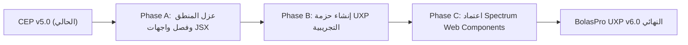

# تقرير التدقيق الفني الشامل للهجرة إلى معيار Adobe UXP (MIG-01)
## Technical Architecture Audit & Migration Roadmap: CEP to UXP

---

### 1. ملخص تنفيذي (Executive Summary)
أعلنت شركة **Adobe** رسمياً عن خطتها الاستراتيجية لإنهاء العمل تدريجياً بمعمارية **CEP (Common Extensibility Platform)** القائمة على متصفح Chromium القديم ومحرك ExtendScript (ES3 يعود لعام 1999)، واستبدالها بنظام **UXP (Unified Extensibility Platform)** الحديث والعصري.

يهدف هذا التقرير إلى تقديم فحص معماري شامل لملفات إضافة **BolasPro v5.0**، وتحليل مدى جاهزيتها للتحول نحو معيار UXP، وتحديد التعديلات البرمجية الضرورية على مستوى واجهة المستخدم (UI)، ومنطق إدارة الحالة (State)، ومحرك التفاعل مع تطبيق After Effects.

---

### 2. الفروقات المعمارية الجوهرية بين CEP و UXP

| الجانب المعماري | نظام CEP الحالي (BolasPro v5.0) | معيار Adobe UXP المستقبلي |
| :--- | :--- | :--- |
| **محرك الواجهة (UI Engine)** | Chromium الكامل (DOM كامل، CSS3، إطارات iframe) | محرك مخصص فائق الخفة (Custom Layout Engine) متوافق جزئياً مع HTML/CSS |
| **محرك السكربت (Host Engine)** | ExtendScript (JavaScript 1.3 / ES3 عتيق وبطيء) | V8 Modern JavaScript Engine (ES6+, Async/Await, Modules) |
| **آلية التواصل (IPC)** | عبر وسيط نصي ثقيل (`csInterface.evalScript`) | استدعاء دوال برمجية مباشرة عبر `require('aftereffects')` ومحرك الوعود |
| **نظام المكونات** | عناصر HTML عادية (`div`, `button`, `select`) | مكونات سبيكتروم القياسية (`sp-button`, `sp-action-button`, `sp-slider`) |
| **الأمان والأذونات** | صلاحيات Node.js مفتوحة في وضعية التبديل | نموذج أمان معزول صارم ومبني على إذن المستخدم (Capabilities-based) |
| **إدارة المعاملات (Undo)** | `app.beginUndoGroup` داخل ExtendScript | `executeAsModal` مع معالجة غير متزامنة ذاتية الإنهاء |

---

### 3. تحليل مكونات BolasPro v5.0 وجاهزيتها للهجرة

#### 3.1 طبقة منطق الحالة (Core Logic & State Management) - [جاهزية: 95%]
* **الملفات المعنية:** `StateManager.js`، `UndoManager.js`، `PresetManager.js`، `I18n.js`.
* **التقييم:** هذه الوحدات مكتوبة بأسلوب Vanilla JavaScript نقي وخالٍ من أي ارتباطات خاصة بـ CEP أو المتصفح. 
* **الإجراء المطلوب للهجرة:** نقلها مباشرة دون تعديل يذكر، مع إمكانية تحويلها إلى ES6 Classes و ES Modules (`export default`).

#### 3.2 طبقة التفاعل مع المضيف (Host Interoperability) - [جاهزية: 70%]
* **الملفات المعنية:** `host-service.js`، `hostscript.jsx`، `Chain.jsx`، `ChainRegistry.jsx`، `ChainInsertion.jsx`.
* **التقييم الحالي:** تعتمد حالياً على تقييم نصوص السكربت `evalScript`، وإرجاع سلاسل نصية JSON يتم فكها لاحقاً.
* **الإجراء المطلوب للهجرة:**
  1. استبدال استدعاءات `evalScript` بمكتبة AE UXP Scripting API المباشرة.
  2. تغليف العمليات الحركية التي تعدل في المشروع بدالة `executeAsModal`:
  ```javascript
  const { app } = require('aftereffects');
  await app.executeAsModal(async (context) => {
      // إنجاز الربط وحساب المصفوفات هنا
  }, { commandName: "BolasPro Snag" });
  ```

#### 3.3 تعابير الأفتر إفكتس (After Effects Expressions) - [جاهزية: 100%]
* **الملف المعني:** `jsx/modules/Expressions.jsx`.
* **التقييم:** التعابير الحركية المحقونة (بما في ذلك فيزياء النوابض والمرونة الجديدة `FEAT-02`، ومصفوفة الـ 3×3 `toWorld`) تُنفذ داخل محرك تعابير After Effects الأصلي (SpiderMonkey JS Engine) في البرنامج نفسه، وهي مستقلة تماماً عن CEP أو UXP.
* **النتيجة:** ستعمل التعابير الحالية بنسبة 100% دون الحاجة إلى تغيير سطر واحد.

#### 3.4 واجهة المستخدم (UI & CSS) - [جاهزية: 60%]
* **التقييم الحالي:** تعتمد الواجهة على CSS Grid ونماذج Flexbox متقدمة مع خط Phosphor Icons.
* **الإجراء المطلوب للهجرة:**
  1. تحويل عناصر الإدخال والأزرار إلى مكتبة **Spectrum Web Components**:
     * `<button class="action-btn">` $\rightarrow$ `<sp-action-button>`
     * `<input type="number">` $\rightarrow$ `<sp-slider>` أو `<sp-number-field>`
     * `<div class="tabs">` $\rightarrow$ `<sp-tabs>`
  2. التحقق من دعم ميزات CSS Grid المعقدة في محرك تخطيط UXP، أو الاستعاضة عنها بنظام Flexbox المتطابق.

---

### 4. خارطة طريق التحول التدريجي (Phased Transition Roadmap)



1. **المرحلة A (تحضيرية - مكتملة بنجاح في v5.0):** عزل موديولات الحالة ومنطق الذاكرة في ملفات مستقلة نظيفة (`core/`).
2. **المرحلة B (بيئة تجريبية Hybrid):** تشغيل الإضافة على بيئة UXP Developer Tool المتاحة مع AE 2024+ واختبار الروابط عبر `executeAsModal`.
3. **المرحلة C (تصميم سبيكتروم):** إعادة رسم الواجهة بمكونات Spectrum لتبدو متماهية 100% مع واجهة After Effects الأصلية.
4. **المرحلة D (الإطلاق):** إصدار النسخة الرسمية `BolasPro v6.0 UXP` ونشرها على متجر Adobe Exchange الحديث.

---
**الخلاصة:**
معمارية BolasPro بعد التحديثات الذرية والتنظيمية في الإصدار 5.0 أصبحت مهيأة بشكل استثنائي للهجرة إلى UXP بأقل جهد هندسي ممكن، ودون المساس بجوهر المنطق الرياضي أو الحركي للسلاسل.
